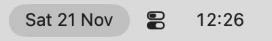
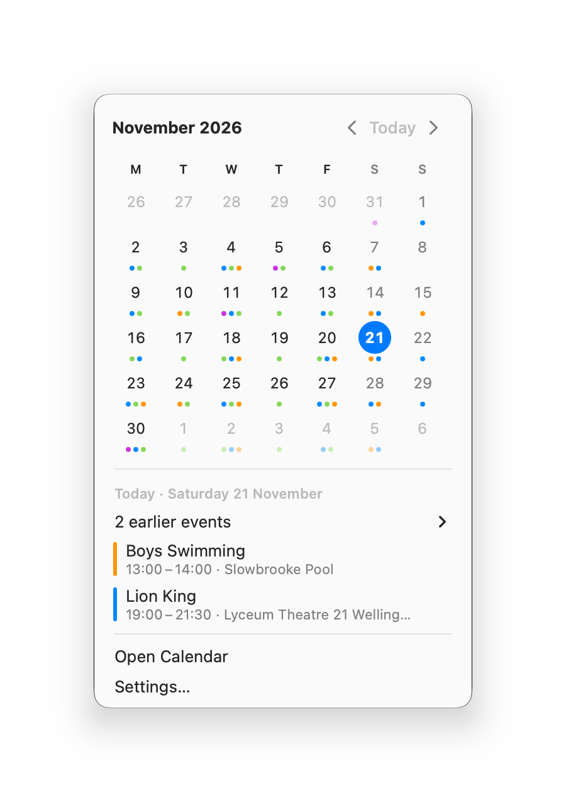
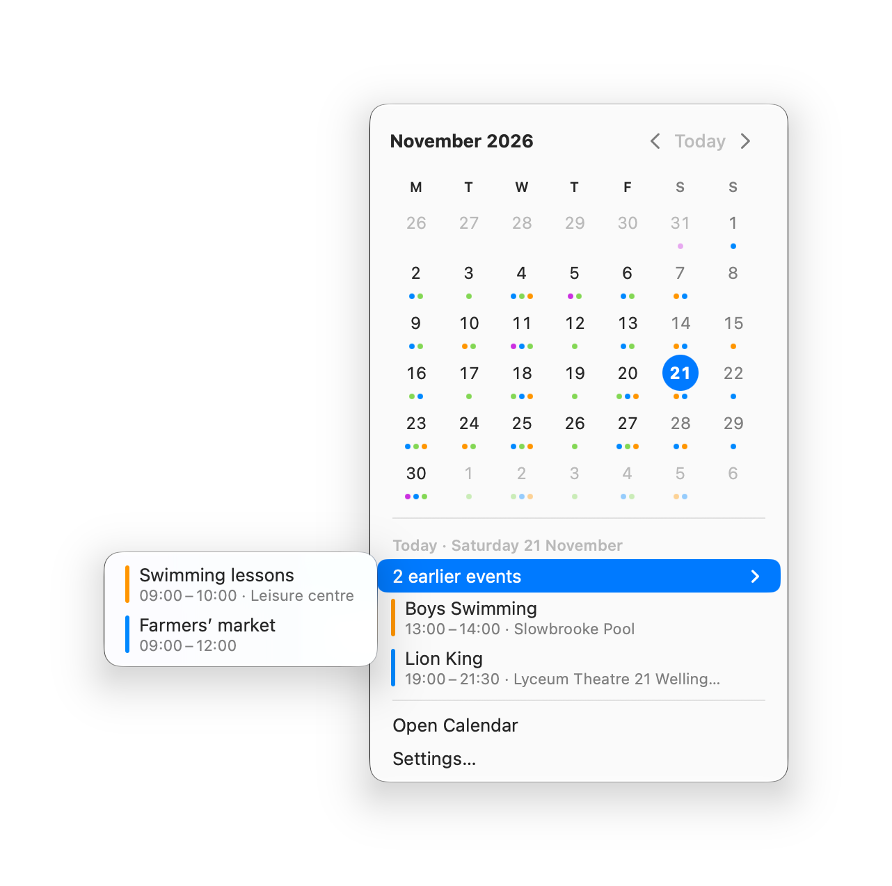

<p align="center">
  
</p>

# Mencal
A Menubar Calendar for macOS

Mencal puts today's date in the menu bar (e.g. `Sat 21 Nov`) in the standard menu bar font. Click it for a menu with a month calendar and the selected day's events, in your Calendar.app colours.

<p align="center">
  
</p>

<p align="center">
  
</p>

## Features

- **Menu bar text only.** Weekday, day and short month by default. Each part (weekday, day, month, year) can be changed, or you can type a Unicode date pattern. Order and punctuation follow your region (System Settings › General › Language & Region).
- **A real menu.** The calendar sits inside a standard `NSMenu`, above ordinary *Open Calendar* and *Settings…* items, so macOS draws, places and tracks it like its own menu bar menus.
- **Month grid.** The first weekday (which can be overridden), numerals and week numbers follow your region. Dots under a day show which calendars have events. The selected day is marked with a circle, as in Calendar.app. Click the month's name to pick another month, and again to pick a year. Swipe sideways with two fingers (or use a mouse wheel) to move a month, year or decade.
- **Day agenda.** The selected day's events are standard menu items under the calendar: the title, the time and location as a subtitle, and a bar in the calendar's colour running beside them, as in Calendar.app. Today's finished events sit in an *earlier events* submenu. Declined invitations and cancelled events are hidden, as in Calendar.app. Up to 8 upcoming events are listed (fewer if the screen is short, so Open Calendar and Settings stay in view); the rest are in a *more events* submenu. Days with over 100 events link to the remainder in Calendar.app.

<p align="center">
  
</p>

- **Read-only.** Mencal never writes to your calendars. Clicking an event opens it in Calendar.app; *Open Calendar* or double-clicking a day opens the app for edits.
- **Settings.** Menu bar format; week start, week numbers, dimmed weekends and all-day events; which calendars to show; open at login; quit. Opening Mencal again (from Finder or Spotlight) shows Settings, in case the menu bar item is hidden.

<p align="center">
  
  
</p>

## Requirements

- macOS 26 (Tahoe) or later
- Xcode 27.2 (the version the project was built and tested with)

## Build & run

```bash
open Mencal.xcodeproj
```

Press ⌘R. The first time you open the menu, click **Allow Calendar Access**. macOS has no read-only calendar permission (reading events needs "Full Access"), but Mencal only reads.

Press ⌘U to run the unit tests (`MencalTests`, Swift Testing); under test the app sets up nothing, so no menu bar item appears and no calendar is read. They cover the month grid in every calendar system, grouping and capping events by day, "Today"/"Tomorrow" across clock and era changes, event time text, the month and year pickers (including era and 13-month years), the event menu items (earlier, more and capped events), cleaning hostile text, and the menu bar format.

The project signs to run locally (`CODE_SIGN_IDENTITY = "-"`), and Release sets `CODE_SIGN_INJECT_BASE_ENTITLEMENTS = NO` so the debug-only `get-task-allow` entitlement never ships. To distribute it, set your Development Team and a Developer ID signing identity in *Signing & Capabilities*, archive (for a universal arm64 + x86_64 build), then notarize.

`TestData/` has `.ics` files to import into Calendar.app for testing; see its README.

## Design notes

- **Read-only by construction.** Only `CalendarStore` imports EventKit. It uses read APIs alone and hands out value copies, never EventKit objects.
- **Energy.** No timers. The date updates only when macOS reports a day, clock, time-zone or region change, on wake, and when the menu opens. Events are read only when the visible month, calendar data or settings change; reopening the menu on unchanged calendars reads nothing, and other months are read off the main thread. The menu's event items are rebuilt only when what they show changes. Calendar syncs while the menu is closed cost almost nothing. The settings window is released when closed.
- **Sizing the menu.** A SwiftUI view that has left a window defers its updates, so the calendar view is built fresh for each opening, measured, then held at that size while open. The events are native items, which `NSMenu` lays out itself when another day is picked.
- **Robust to hostile feeds.** All feed text (titles, locations, calendar names) is put on one line, stripped of invisible and reordering characters and capped by Unicode scalar before it's kept, then shown as plain text. Events are grouped by binary search, with all-day and timed events capped at 100 a day each, so spam can't push out real meetings. Hidden calendars stay hidden when a resync changes their identifiers.
- **Sandboxed.** App Sandbox and Hardened Runtime, with the calendars entitlement and nothing else (no network access).

## Project layout

```
Mencal/
  App/MencalMain.swift                 Entry point, app delegate, key-equivalent menu
  App/StatusItemController.swift       NSStatusItem + NSMenu hosting the SwiftUI calendar
  App/DayEventMenuItems.swift          The selected day's events as native menu items
  App/SettingsWindowController.swift   Toolbar-tab settings window
  App/ExternalApps.swift               Hand-offs to Calendar.app and System Settings
  App/CalendarHostingView.swift        Hosts the calendar; turns swipes and the scroll wheel into navigation
  Model/CalendarStore.swift            Read-only EventKit access, and the events already read
  Model/DisplayText.swift              Makes untrusted feed text safe to show on one line
  Model/DateTicker.swift               Current date, updated from system notifications
  Model/EventLayout.swift              Date logic: grid days, grouping events by day, time text
  Model/MenuBarFormat.swift            Region-aware menu bar text and its options
  Model/Preferences.swift              Settings keys and defaults
  Views/                               Calendar menu, month grid, month and year pickers, settings tabs
  Localizable.xcstrings, InfoPlist.xcstrings   String catalogs (plurals, privacy prompt)
  AppIcon.icon/                        Layered Liquid Glass app icon (open in Icon Composer)
MencalTests/                           Unit tests (Swift Testing)
```
