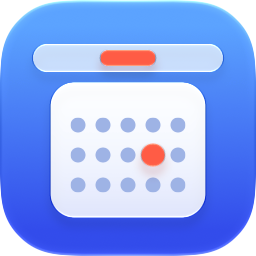
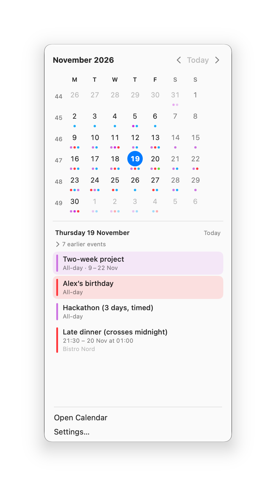
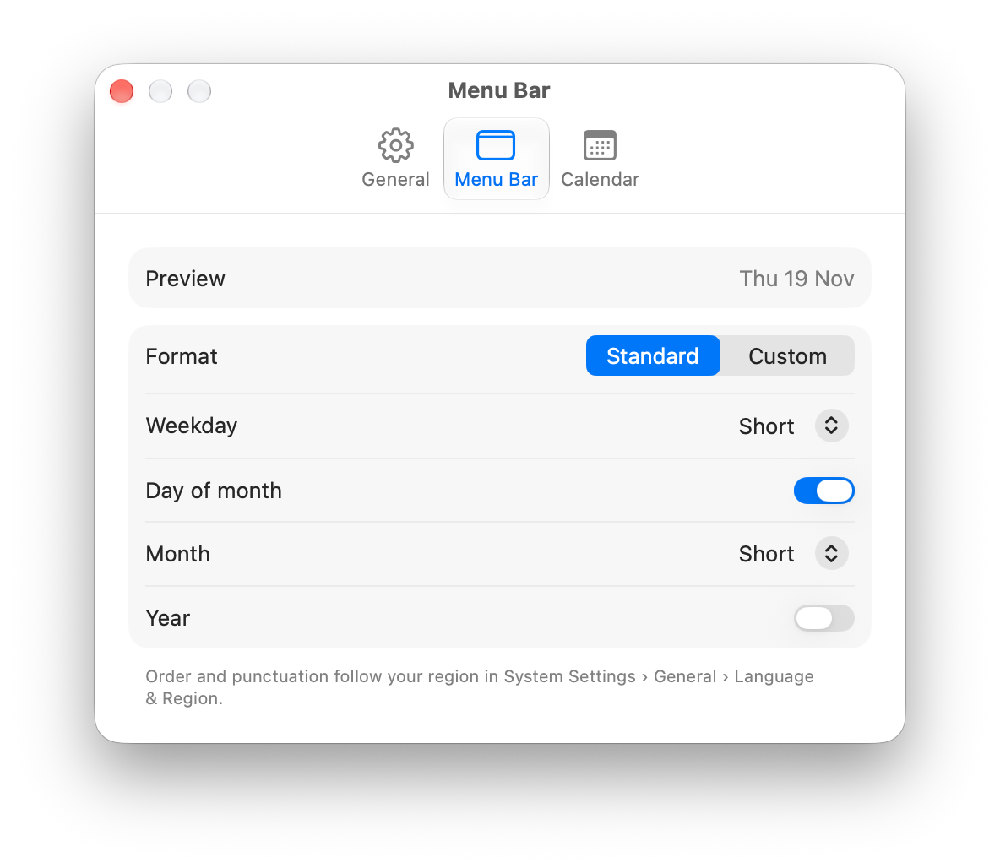
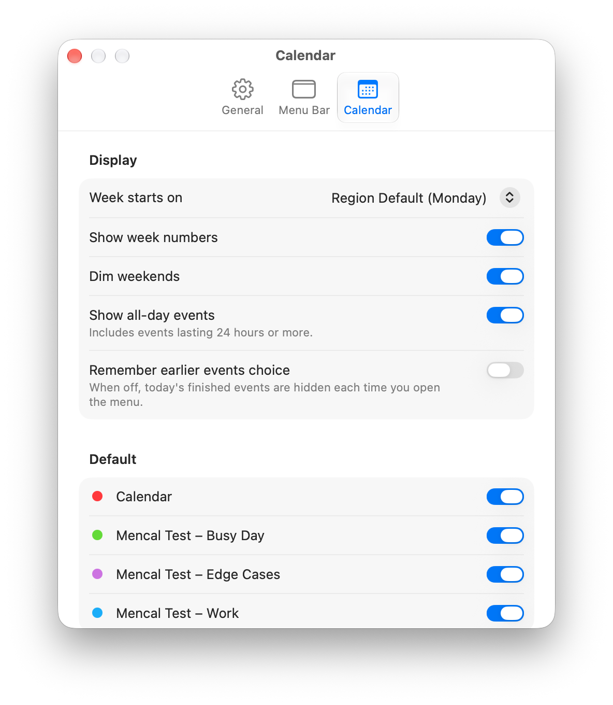

<p align="center">
  <picture>
    <source media="(prefers-color-scheme: dark)" srcset="docs/images/app-icon-dark.png">
    
  </picture>
</p>

# Mencal
A Menubar Calendar for macOS

Mencal puts today's date in the menu bar (e.g. `Thu 19 Nov`) in the standard menu bar font. Click it for a menu with a month calendar and the selected day's events, in your Calendar.app colours.

<p align="center">
  <picture>
    <source media="(prefers-color-scheme: dark)" srcset="docs/images/menu-bar-dark.png">
    
  </picture>
</p>

<p align="center">
  <picture>
    <source media="(prefers-color-scheme: dark)" srcset="docs/images/calendar-menu-dark.png">
    
  </picture>
</p>

## Features

- **Menu bar text only.** Weekday, day and short month by default. Each part (weekday, day, month, year) can be changed, or you can type a Unicode date pattern. Order and punctuation follow your region (System Settings › General › Language & Region).
- **A real menu.** The calendar sits inside a standard `NSMenu`, above ordinary *Open Calendar* and *Settings…* items, so macOS draws, places and tracks it like its own menu bar menus.
- **Month grid.** The first weekday (which can be overridden), numerals and week numbers follow your region. Dots under a day show which calendars have events. The selected day has a Liquid Glass bubble.
- **Day agenda.** All-day events first, then timed events with times and locations. Today's finished events are tucked behind an *earlier events* toggle.
- **Read-only.** Mencal never writes to your calendars. Clicking an event opens it in Calendar.app; *Open Calendar* or double-clicking a day opens the app for edits.
- **Settings.** Menu bar format; week start, week numbers, dimmed weekends, all-day events and whether to remember the earlier-events choice; which calendars to show; open at login; quit.

<p align="center">
  
  
</p>

## Requirements

- macOS 26 (Tahoe) or later
- Xcode 26 or later

## Build & run

```bash
open Mencal.xcodeproj
```

Press ⌘R. The first time you open the menu, click **Allow Calendar Access**. macOS has no read-only calendar permission (reading events needs "Full Access"), but Mencal only reads.

The project signs to run locally (`CODE_SIGN_IDENTITY = "-"`). To distribute it, set your Development Team and a Developer ID signing identity in *Signing & Capabilities*, then notarize.

`TestData/` has `.ics` files to import into Calendar.app for testing; see its README.

## Design notes

- **Read-only by construction.** Only `CalendarStore` imports EventKit. It uses read APIs alone and hands out value copies, never EventKit objects.
- **Energy.** No timers. The date updates only when macOS reports a day, clock, time-zone or region change, on wake, and when the menu opens. Events are fetched once per opening, and again only when the visible month, calendar data or settings change. Calendar syncs while the menu is closed cost almost nothing. The settings window is released when closed.
- **Sandboxed.** App Sandbox and Hardened Runtime, with the calendars entitlement and nothing else (no network access).

## Project layout

```
Mencal/
  App/MencalMain.swift                 Entry point, app delegate, key-equivalent menu
  App/StatusItemController.swift       NSStatusItem + NSMenu hosting the SwiftUI calendar
  App/SettingsWindowController.swift   Toolbar-tab settings window
  App/ExternalApps.swift               Hand-offs to Calendar.app and System Settings
  Model/CalendarStore.swift            Read-only EventKit access
  Model/DateTicker.swift               Current date, updated from system notifications
  Model/MenuBarFormat.swift            Region-aware menu bar text and its options
  Model/Preferences.swift              Settings keys and defaults
  Views/                               Calendar menu, month grid, event list, settings tabs
  AppIcon.icon/                        Layered Liquid Glass app icon (open in Icon Composer)
```
